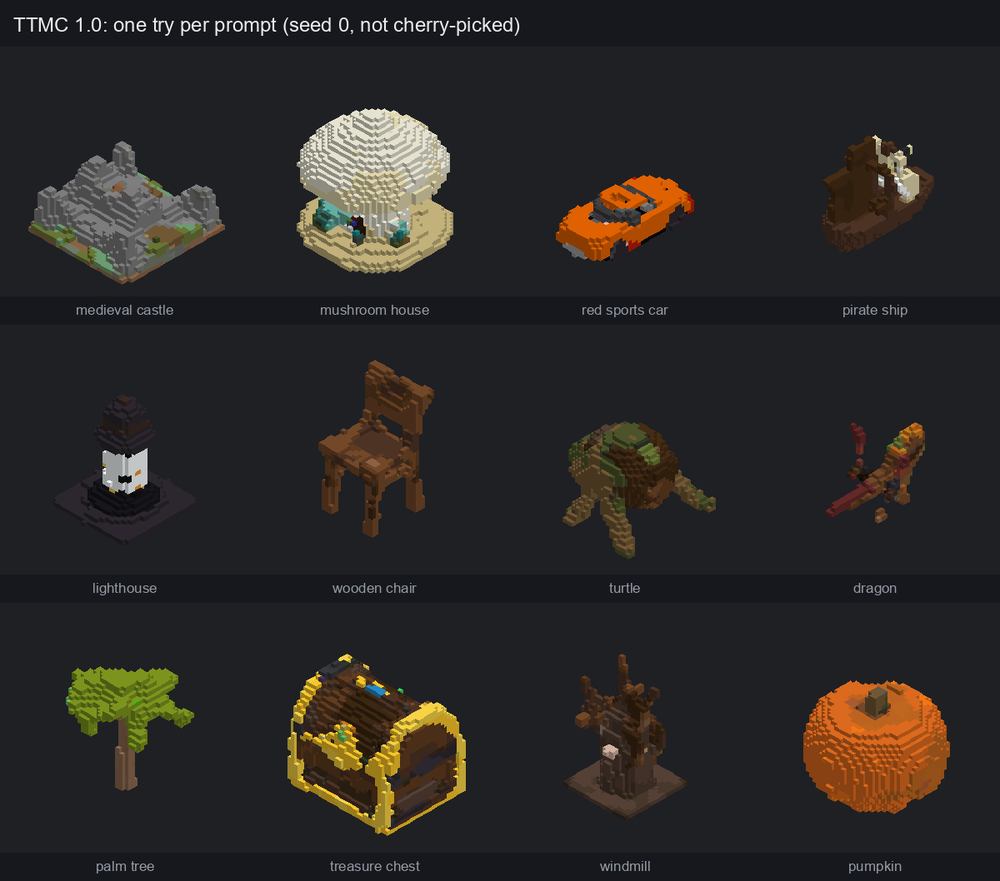
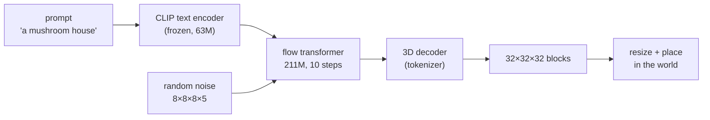
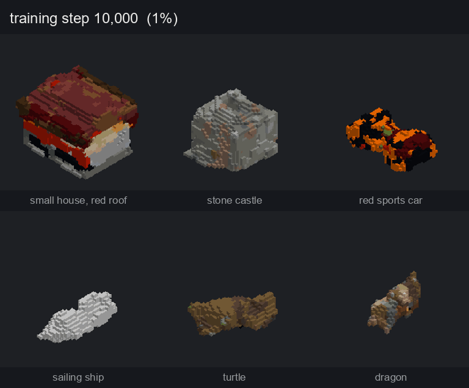
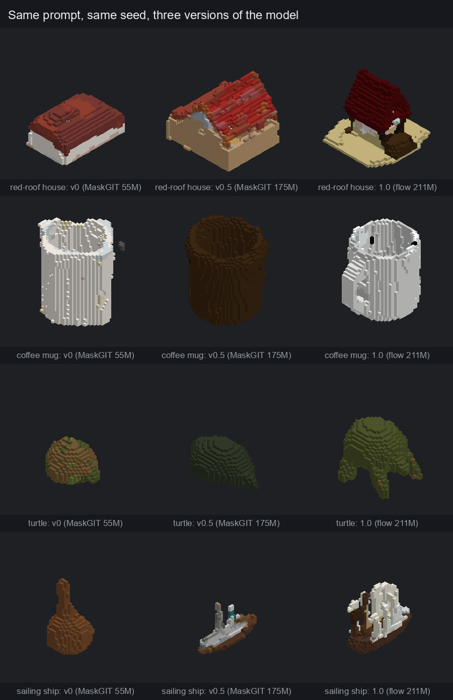
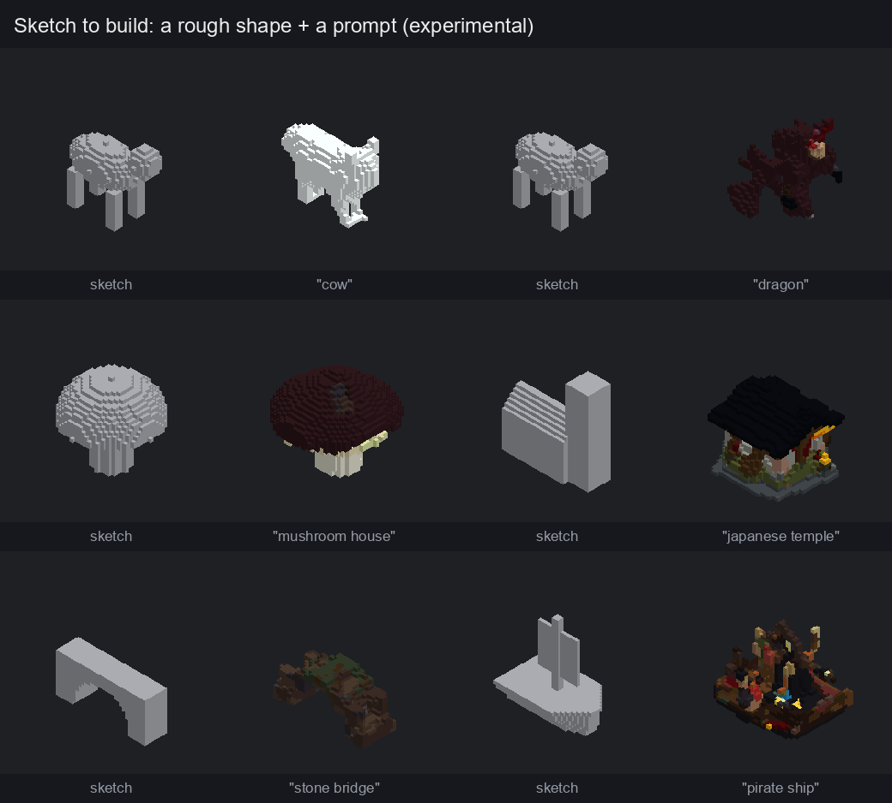

<div align="center">

# TTMC: Text To Minecraft

**Type a prompt. Get a build. Free, offline, on your own PC.**

[](LICENSE)


<!-- SCREENSHOTS: put in-game screenshots in docs/images/ and uncomment, e.g.
 
-->



</div>

TTMC is a Minecraft mod with its own text-to-voxel AI model. Type `/ttmc a mushroom house`
and the build appears in front of you, block by block.

- **Free and offline.** The model runs locally on your CPU: no account, no API key, no
  internet after the download.
- **Trained from scratch** on 527,084 3D models: a 3D tokenizer and a 211M-parameter
  diffusion transformer, built for Minecraft blocks.
- **Open.** Code, weights and the full training pipeline are MIT-licensed.

---

## Install

You need **Minecraft Java 26.2**, [Fabric Loader](https://fabricmc.net/use/) and
[Fabric API](https://modrinth.com/mod/fabric-api).

1. Download from the [latest release](../../releases/latest):
   - `ttmc-1.0.0.jar`: the mod
   - `ttmc-model-1.0.zip`: the model (~1.1 GB)
2. Put `ttmc-1.0.0.jar` in your `.minecraft/mods/` folder.
3. Unzip `ttmc-model-1.0.zip` into `.minecraft/config/ttmc/`, so that
   `.minecraft/config/ttmc/ttmc.json` exists.
4. Start Minecraft with the Fabric profile and open a world with **cheats / commands on**
   (or Esc → Open to LAN → Allow Commands: ON).

## Use it

| Command | What it does |
|---|---|
| `/ttmc a red sports car` | Builds it 2 blocks in front of you, on the ground |
| `/ttmc small a wooden chair` | Size words: `tiny` 8, `little` 12, `small` 16, `medium` 24, `big` 32, `huge` 48, `giant` 64 blocks |
| `/ttmc a lighthouse, 40 blocks tall` | Exact size: `N blocks tall`, `N blocks wide`, or `N blocks` (longest side), up to 64 |
| `/ttmc undo` | Removes your last build and restores what was there (10 levels) |

A build takes **about 20 seconds** on a 6-core CPU (the first one a little longer while the
model loads). Every run uses a new random seed, so **if you don't like a result, run it
again**.

**Prompts that work well** are short and concrete, ideally a color plus an object:
"a red barn", "a stone well", "a blue bicycle", "a pirate ship". Common objects, furniture,
vehicles, buildings, trees and animals work best; very rare or abstract things are hit or
miss.

---

## How it works



Two models, both trained from scratch for this project:

1. **A 3D tokenizer** compresses a 32×32×32 grid of Minecraft blocks into an 8×8×8 grid of
   5 numbers each (an FSQ autoencoder, 15,360 possible codes per cell), and decodes it back.
   It learned to reconstruct builds from 527k examples, without any text.
2. **A flow-matching transformer** (rectified flow, DiT-style with adaLN-Zero and QK-norm,
   16 layers, 211M parameters) learns to turn random noise into that compressed latent,
   guided by the prompt through cross-attention to CLIP text features. At generation time it
   takes 10 denoising steps with classifier-free guidance (scale 7.5).

The decoder turns the latent into blocks, the mod crops and scales the result to the size you
asked for, and places it. Everything runs through [ONNX Runtime](https://onnxruntime.ai/) in
Java, so players don't need Python or a GPU.

## Training

**Data.** 527,084 3D models from [Objaverse](https://objaverse.allenai.org/) (only CC0 and
CC BY licenses, so the weights can be released), each voxelized to a 64³ grid, with every
color mapped to the closest Minecraft block, then downsampled to 32³ and seen in 8
orientations. Captions come from [Cap3D](https://huggingface.co/datasets/tiange/Cap3D), plus
short casual versions ("a turtle") because players type short prompts.

**Compute.** The final model trained for 40.8 hours on one rented RTX 4090: 910,000 steps,
about 15 million examples, **about $36**. All rented GPU time for the project, including the
earlier models and failed experiments, came to about $59.

<div align="center">


*The same six prompts over the course of training, from noise-like blobs to buildings.*
</div>

**Getting here.** v0 was a 55M MaskGIT transformer on 48k objects. Scaling MaskGIT to 175M
parameters and all 527k objects helped, but an audit showed it ignored the prompt once some
codes were placed and could not get fine structure right. Switching to flow matching on the
tokenizer's continuous latent fixed both: a 71M flow model trained for 6 hours on a home GPU
already matched the 175M MaskGIT model, and the 211M version is clearly better.

<div align="center">

</div>

## Experimental: sketch to build

Because the model is a diffusion model, it can also start from your own rough shape instead
of pure noise (SDEdit). Block out a shape in gray wool, give it a prompt, and the model
keeps your proportions while filling in the detail, with no retraining needed. Same sketch,
different prompt, different build:

<div align="center">

</div>

This works in Python today (`scripts/sketch_build.py`); an in-game `/ttmc sketch` command is
planned.

## Limitations

- **Resolution.** Builds are generated at 32³ and scaled; fine detail (faces, text, thin
  parts) is beyond it.
- **Not Minecraft-native yet.** It learned from general 3D models, so it uses full blocks
  only: no stairs, slabs or fences, and no builder conventions. Interiors are not designed
  to be walked into.
- **Rare prompts** with few training examples come out vague, and colors sometimes drift
  (a "red" car can come out orange). Run it again.
- **Speed.** About 20 s per build on CPU; there is no GPU path in the mod yet.

## Roadmap

- `/ttmc sketch`: sketch to build in game
- A sharper tokenizer (continuous latents, more channels) for crisper builds at 32³, then 64³
- Survival mode: build from a ghost blueprint with a material list
- **v2: Minecraft-native.** A community dataset of real Minecraft builds, so the model learns
  stairs, roofs, terrain and the style of the builds around it

## Run and train it yourself

```bash
python -m venv .venv
.venv/Scripts/pip install torch --index-url https://download.pytorch.org/whl/cu128
.venv/Scripts/pip install -r requirements.txt
```

The model checkpoints are on Hugging Face (see the release notes). Then:

| Script | Purpose |
|---|---|
| `scripts/objaverse_build.py`, `make_vox32.py` | download and voxelize Objaverse |
| `scripts/train_vqvae.py`, `encode_codes.py` | train the 3D tokenizer, encode the dataset |
| `scripts/train_flow.py` | train the flow transformer (time budget, EMA, divergence guard) |
| `scripts/tune_flow.py` | sampling-settings grid scored with CLIP |
| `scripts/sketch_build.py` | sketch to build |
| `scripts/export_onnx.py` | export to ONNX for the mod (verified against PyTorch) |
| `scripts/runpod_launch.py`, `runpod_watch.py` | one-command training on a rented GPU |
| `mod/` | the Fabric mod (Java 25, `./gradlew build`) |

## Credits and license

Code and model weights: [MIT](LICENSE).

The model was trained on 3D models from **Objaverse** (Deitke et al., 2023), created by
their authors on Sketchfab and used under CC BY 4.0 and CC0. Captions come from **Cap3D**
(Luo et al., 2023, ODC-By). The full list of the 527,084 models and their authors is in
[ATTRIBUTION.md](ATTRIBUTION.md). Text encoding uses OpenAI's
[CLIP ViT-B/32](https://huggingface.co/openai/clip-vit-base-patch32) (MIT).

TTMC is not affiliated with Mojang or Microsoft. No Minecraft assets are included: the mod
only stores block names and their average colors.
